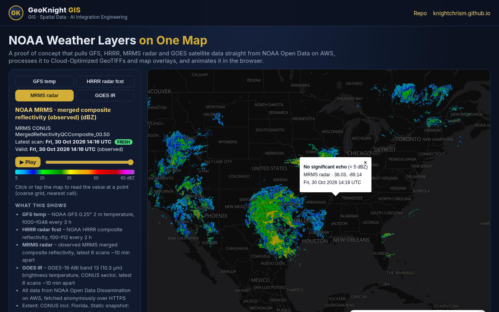

<div align="center">

# 🌐 GeoKnight GIS — NOAA Weather Layers POC

**GIS · Spatial Data · AI Integration Engineering**

GFS, HRRR, MRMS radar and GOES satellite layers on one map over CONUS + Florida, pulled from NOAA Open Data on AWS and animated in MapLibre GL.

[](https://knightchrism.github.io/weather-poc/)


**▶ Live demo: https://knightchrism.github.io/weather-poc/**



</div>

## Layers (implemented)
| Picker | Source bucket | Exact product / variable | Time steps | Stored grid | Units |
|---|---|---|---|---|---|
| GFS temp | `noaa-gfs-bdp-pds` | `gfs.tCCz.pgrb2.0p25.fFFF`, message `TMP:2 m above ground` | one run, f000–f048 every 3 h | 0.25° (native) | COG °C, display °F |
| HRRR radar fcst | `noaa-hrrr-bdp-pds` | `hrrr.tCCz.wrfsfcfFF.grib2` (CONUS), message `REFC:entire atmosphere` (composite reflectivity) | latest run with f12 available, f00–f12 every 2 h | 0.05° (downsampled from 3 km Lambert) | dBZ |
| MRMS radar | `noaa-mrms-pds` | `CONUS/MergedReflectivityQCComposite_00.50/…grib2.gz` | latest 6 files ≥ ~10 min apart | 0.02° (max-resampled from 0.01°) | dBZ |
| GOES IR | `noaa-goes19` | `ABI-L2-CMIPC` (CONUS sector), band 13 (10.3 µm clean IR), variable `CMI` | latest 6 scans ≥ ~10 min apart | 0.05° (reprojected from 2 km geostationary) | °C brightness temp |

All fetched anonymously over HTTPS. Exact source URL of every frame is in `data/<layer>/manifest.json`; per-frame QC stats in `qc_report.json`.

## How to run
```bash
python3 -m venv .venv && . .venv/bin/activate && pip install -r requirements.txt
python pipeline.py                     # all layers (downloads ~50 MB)
python pipeline.py config.yaml mrms    # just one layer
python -m http.server 8000             # open http://localhost:8000
```

## Architecture
Static site + offline, config-driven Python pipeline. No server-side code.

```
NOAA Open Data on AWS (anonymous HTTPS)
 ├─ GFS / HRRR : .idx lookup → HTTP Range request for one GRIB2 message   (reader: grib_idx)
 ├─ MRMS       : latest .grib2.gz files, gunzip                            (reader: grib_gz)
 └─ GOES-19    : latest ABI L2 CMIPC band-13 netCDF, geostationary grid    (reader: goes_nc)
        │
        ▼  pipeline.py (shared processing for every layer)
 reproject to common EPSG:4326 grid (rasterio/GDAL/PROJ) → unit conversion
   → Cloud-Optimized GeoTIFF (DEFLATE) + Web-Mercator-spaced PNG overlay + coarse JSON grid
   → QC (value range, NaN fraction, completeness) → manifest.json per layer + data/layers.json
        │
        ▼
 index.html (MapLibre GL image sources, layer picker, legend, time slider, FRESH/STALE badge, click-to-read)
```

- **Config-driven:** each layer in `config.yaml` declares bucket, key template or prefix, reader, variable match, time mode (`forecast` run+hours or `observed` latest N files), grid resolution, unit conversion, QC limits, staleness threshold and colour ramp. The front end reads `data/layers.json`, so adding a layer needs no JS changes.
- **Discovery:** forecast layers pick the newest cycle whose last forecast hour `.idx` exists; observed layers list the S3 prefix for the last few hours.
- **FRESH/STALE:** computed in the browser against `stale_hours` per layer (GFS 12 h, HRRR 3 h, MRMS 1 h, GOES 1 h). Because the site is a static snapshot, layers will show STALE until the pipeline is rerun.
- **QC:** non-zero exit if any frame is out of range or exceeds its allowed NaN fraction (e.g. MRMS outside radar coverage, GOES CONUS sector edge).

## Possible production mapping on AWS (not implemented)
| POC piece | Production |
|---|---|
| manual run | **EventBridge** schedule or SNS new-object notifications from the NOAA buckets |
| `pipeline.py` | container on **ECS Fargate** (or AWS Batch / Step Functions fan-out per frame) |
| `data/` | **S3** bucket of COGs + manifests, versioned by run, lifecycle rules for retention |
| PNG overlays | **TiTiler** serving dynamic XYZ tiles / point queries from COGs |
| JSON grid | TiTiler `/point` endpoint (or a small Lambda) |
| `qc_report.json` | CloudWatch metrics + alarms; failed QC blocks manifest promotion |
| static `index.html` | S3 + **CloudFront** |

## Limitations
- **Static snapshot:** data in the repo is from a single pipeline run; nothing refreshes automatically.
- **Downsampled to keep the repo small:** HRRR and GOES stored at 0.05°, MRMS at 0.02°; total `data/` is roughly 36 MB, largest single file under 2 MB.
- PNG overlays rather than tiles: pixelated when zoomed in.
- Click-to-read uses a coarse grid (1° GFS, 0.25° others, nearest cell); COGs hold the full stored grid.
- One variable per model; GOES is single-band IR (no true-colour GeoColor composite).
- MapLibre and the OpenFreeMap basemap are loaded from CDNs.

## Credits
- **Data** (via the [NOAA Open Data Dissemination](https://www.noaa.gov/information-technology/open-data-dissemination) program on AWS):
  NOAA/NCEP Global Forecast System (GFS); NOAA/NCEP High-Resolution Rapid Refresh (HRRR);
  NOAA NSSL/NCEP Multi-Radar/Multi-Sensor System (MRMS); NOAA GOES-R Series / NESDIS (GOES-19 ABI).
- **Libraries:** [MapLibre GL JS](https://maplibre.org/), [xarray](https://xarray.dev/), [cfgrib](https://github.com/ecmwf/cfgrib)/ecCodes, [rasterio](https://rasterio.readthedocs.io/) (GDAL/PROJ), h5netcdf/h5py, NumPy, Pillow, PyYAML, Requests; Playwright for screenshots.
- **Basemap:** [OpenFreeMap](https://openfreemap.org/) © OpenMapTiles © OpenStreetMap contributors.
- Built by Christopher Knight / GeoKnight GIS, with AI coding assistance.
